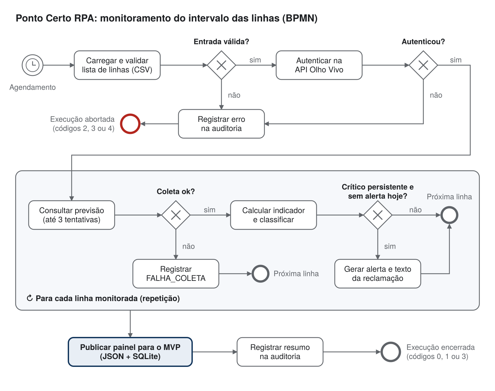

# Ponto Certo RPA

Automação que monitora o intervalo dos ônibus municipais de São Paulo e entrega ao MVP
**Ponto Certo** a situação de cada linha, com alerta e texto de reclamação quando o atraso persiste.

Global Solution 2026.2 · FIAP · Engenharia de Software 4ES · Robotic Process Automation
Atividade: *Do Processo Manual à Automação Inteligente*

## Integrantes

| Nome completo | RM |
| --- | --- |
| Filipe Prado Menezes | 98765 |
| Cássio Eid Kobaysahi Yonetsuka | 99678 |
| Pedro Henrique Salvitti Habiro | 88166 |

## Links

- Vídeo de demonstração: https://youtu.be/hc0wqeQG_ac
- Relatório técnico (PDF): [docs/Relatorio_Tecnico_RPA_Ponto_Certo.pdf](docs/Relatorio_Tecnico_RPA_Ponto_Certo.pdf)
- MVP Ponto Certo (GitHub Pages): https://flipew.github.io/ponto-certo-rpa/
- Dados para o MVP (JSON): https://flipew.github.io/ponto-certo-rpa/painel_linhas.json

## O problema

A longa espera foi a principal reclamação sobre ônibus municipais em São Paulo em 2025:
19.310 queixas, 40% do total registrado no SP156
([Folhapress](https://www.acessa.com/noticias/2026/04/321109-linha-de-onibus-da-zona-norte-lidera-queixas-de-passageiros-em-sao-paulo.html)).
Conferir à mão, linha por linha, se o intervalo programado está sendo cumprido não escala.
O robô faz isso sozinho a cada 5 minutos.

## O que a automação faz

1. Lê a lista de linhas monitoradas (CSV) e rejeita registros inválidos ou duplicados.
2. Autentica na API Olho Vivo da SPTrans.
3. **Para cada linha** (repetição), consulta a previsão de chegada na parada de referência.
4. Calcula o intervalo observado e **decide** a classificação: `NORMAL`, `ATENCAO`, `CRITICO` ou `SEM_PREVISAO`.
5. Se a linha ficar crítica em 2 execuções seguidas e ainda não houver alerta no dia, gera o alerta e o texto da reclamação para o SP156.
6. Publica o resultado para o MVP: banco SQLite, arquivo JSON e API de leitura.
7. Registra tudo em log de auditoria (JSON Lines).



Detalhes do processo, regras e exceções: [docs/PDD.md](docs/PDD.md).

## Arquitetura

```
config/linhas_monitoradas.csv ──┐
                                ▼
API Olho Vivo (SPTrans) ──► robô (src/ponto_certo) ──► saida/ponto_certo.db ──┐
   ou simulador                  │                 └─► saida/painel_linhas.json ├─► MVP Ponto Certo
                                 ▼                                              │   (GET /api/status)
                      logs/auditoria-AAAA-MM-DD.jsonl        API de leitura ◄───┘
```

| Pasta | Conteúdo |
| --- | --- |
| `src/ponto_certo/` | Código-fonte: `robo.py` (fluxo), `regras.py` (decisão), `olho_vivo.py` (API real), `simulador.py`, `entrada.py`, `saida.py`, `auditoria.py`, `api.py`, `config.py` |
| `config/` | Lista de linhas do modo real |
| `simulacao/` | Lista e cenário do modo simulado |
| `mvp/` | Tela do MVP: página estática que lê `painel_linhas.json` |
| `.github/workflows/` | Execução agendada do robô e publicação do painel no GitHub Pages |
| `docs/` | PDD e fluxo BPMN |
| `logs/` | Amostra do log de auditoria (sem dados sensíveis) |
| `tests/` | Testes automatizados e evidências |
| `assets/` | Amostra do painel entregue ao MVP |

Power Automate não foi usado, por isso não há pasta `power-automate/`.

## Como rodar

Requer Python 3.10 ou superior.

```bash
git clone <url-do-repositorio>
cd ponto-certo-rpa
pip install -r requirements.txt
```

### Demonstração (modo simulado, sem token)

```bash
python rpa.py executar          # rode 2 vezes: o alerta sai na 2ª execução
python rpa.py servir            # abra http://localhost:8000
```

O modo simulado devolve respostas no mesmo formato da API real, a partir de
[`simulacao/cenario_padrao.json`](simulacao/cenario_padrao.json). O cenário padrão tem uma linha
normal, uma em atenção, uma crítica, uma sem ônibus previsto e uma com a API fora do ar.
A lista [`simulacao/linhas_demo.csv`](simulacao/linhas_demo.csv) inclui de propósito um registro
duplicado e dois inválidos, para mostrar a rejeição.

### Modo real (API Olho Vivo)

1. Crie uma conta em <https://www.sptrans.com.br/desenvolvedores/> e gere um token em *Meus Aplicativos*.
2. Copie `.env.example` para `.env` e preencha `OLHO_VIVO_TOKEN`.
3. Confirme os códigos de linha e de parada: `python rpa.py descobrir --linha 8000`.
4. Ajuste `config/linhas_monitoradas.csv`.
5. Rode `python rpa.py executar --modo real`.

> **Atenção:** os códigos de linha e de parada e os intervalos programados que vêm em
> `config/linhas_monitoradas.csv` são **exemplos** e precisam ser conferidos. O intervalo
> programado de cada linha está no GTFS da SPTrans (`frequencies.txt`, campo `headway_secs`).
> O cliente da API real foi testado com sessão HTTP simulada, não contra a API em produção.

### Execução automática e MVP publicado (GitHub Actions + Pages)

O workflow [`.github/workflows/monitorar.yml`](.github/workflows/monitorar.yml) roda o robô a cada
10 minutos, das 5h às 23h, sem ninguém acionar. A cada execução ele:

1. roda os testes;
2. recupera o banco da execução anterior (branch `gh-pages`), para manter a contagem de medições críticas;
3. executa o robô, em modo real se o segredo `OLHO_VIVO_TOKEN` existir, senão em modo simulado;
4. guarda o log de auditoria como artefato da execução;
5. publica `mvp/index.html` e `painel_linhas.json` na branch `gh-pages`, que o GitHub Pages serve em URL pública.

Para ativar: em *Settings > Secrets and variables > Actions*, crie o segredo `OLHO_VIVO_TOKEN`;
em *Settings > Pages*, escolha a branch `gh-pages`. O workflow
[`descobrir.yml`](.github/workflows/descobrir.yml) consulta os códigos reais de linha e parada.

### Execução local sem intervenção humana

```bash
python rpa.py executar --modo real --repetir-min 5
```

Ou agende no sistema. Exemplo de cron, a cada 5 minutos das 5h às 23h:

```
*/5 5-23 * * * cd /caminho/ponto-certo-rpa && python rpa.py executar --modo real
```

No Windows, use o Agendador de Tarefas com a mesma linha de comando.

### Códigos de saída

| Código | Significado |
| --- | --- |
| 0 | Concluída |
| 1 | Concluída com falha em parte das linhas |
| 2 | Abortada: token ausente ou recusado |
| 3 | Fonte de dados indisponível |
| 4 | Configuração inválida |
| 5 | Erro inesperado |

## Integração com o MVP

O MVP lê; o robô grava. Três formas de consumo, com o mesmo conteúdo:

| Forma | Onde | Uso |
| --- | --- | --- |
| Arquivo JSON publicado | `painel_linhas.json` no GitHub Pages | Tela do MVP (`mvp/index.html`) |
| API HTTP local | `GET /api/status`, `GET /api/alertas`, `GET /api/execucoes` | Desenvolvimento e outros componentes |
| Banco SQLite | `saida/ponto_certo.db` (tabelas `execucoes`, `medicoes`, `alertas`) | Consultas e histórico |

Exemplo de resposta: [`assets/amostra_painel_linhas.json`](assets/amostra_painel_linhas.json).

## Testes

```bash
python -m pytest -v
```

44 testes cobrindo sucesso, decisão e falha. Detalhes em [tests/EVIDENCIAS.md](tests/EVIDENCIAS.md).

## Segurança e LGPD

- **Sem dados pessoais.** A automação trata só dados públicos de operação: linha, parada, horário previsto e prefixo do veículo. Não coleta nome, documento, localização de passageiro nem dados de motorista.
- **Credencial fora do código.** O token vem de variável de ambiente ou do `.env`, que está no `.gitignore`.
- **Token fora dos logs.** Mensagens de erro não incluem a URL de login, e campos com nome de segredo são mascarados na auditoria.
- **Reclamação não é enviada sozinha.** O robô gera o texto; quem decide enviar ao SP156 é o cidadão, pelo MVP.
- **API somente leitura.** A API do robô não aceita escrita.
