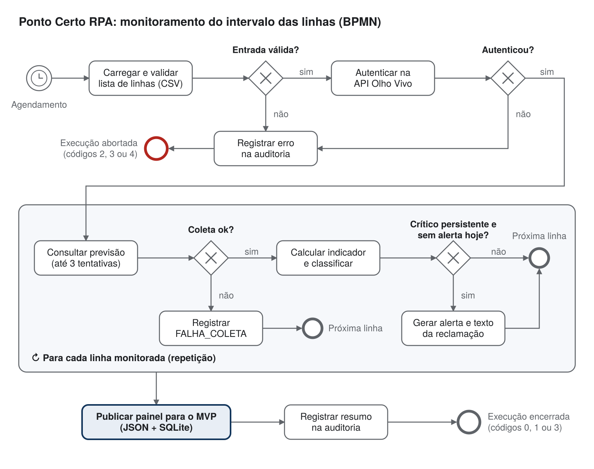

# PDD: Monitoramento do intervalo das linhas (Ponto Certo)

Documento de Definição do Processo da automação. O desenho em BPMN está em
[`fluxo_bpmn.png`](fluxo_bpmn.png) (fonte: `fluxo_bpmn.svg`, gerado por `gerar_fluxo_bpmn.py`).

## 1. Processo manual (como era)

Para saber se uma linha está cumprindo o intervalo, uma pessoa precisaria:

1. Abrir o Olho Vivo e procurar a linha.
2. Olhar a previsão de chegada na parada.
3. Comparar de cabeça com o intervalo programado.
4. Anotar o resultado em uma planilha.
5. Repetir para cada linha, várias vezes por dia.
6. Se o atraso persistir, redigir a reclamação com linha, parada, data e horário.

É repetitivo, sujeito a erro e não escala além de poucas linhas.

## 2. Processo automatizado (como ficou)

| Item | Definição |
| --- | --- |
| Gatilho | Agendamento: GitHub Actions a cada 10 minutos, ou local com `--repetir-min 5`, cron ou Agendador de Tarefas |
| Entrada | CSV de linhas monitoradas: linha, código da linha, código da parada, nome da parada, intervalo programado |
| Fonte de dados | API Olho Vivo da SPTrans (`/Login/Autenticar`, `/Previsao`) ou o simulador |
| Saídas | `saida/ponto_certo.db` (SQLite), `saida/painel_linhas.json`, API de leitura, log de auditoria |
| Intervenção humana | Nenhuma na execução. Só para manter a lista de linhas e o token |

## 3. Etapas

| # | Etapa | Módulo |
| --- | --- | --- |
| 1 | Carregar e validar a lista de linhas. Registros inválidos ou duplicados são rejeitados e auditados | `entrada.py` |
| 2 | Autenticar na API | `olho_vivo.py` |
| 3 | **Repetição:** para cada linha válida, consultar a previsão na parada de referência (até 3 tentativas, espera de 1 s, 2 s) | `robo.py`, `olho_vivo.py` |
| 4 | Calcular o indicador e classificar a situação | `regras.py` |
| 5 | **Decisão:** gerar alerta se a situação for crítica em 2 execuções seguidas e ainda não houver alerta para a linha no dia | `robo.py`, `saida.py` |
| 6 | Publicar o painel para o MVP (escrita atômica) e gravar no banco | `saida.py` |
| 7 | Registrar o resumo da execução na auditoria e devolver o código de saída | `auditoria.py`, `robo.py` |

## 4. Regras de negócio

- **Indicador (min)** = o maior entre a espera até o próximo ônibus e o intervalo entre o 1º e o 2º ônibus previstos.
- **Razão** = indicador / intervalo programado.

| Condição | Classificação |
| --- | --- |
| Nenhum ônibus previsto | `SEM_PREVISAO` (tratada como crítica) |
| Razão até 1,2 | `NORMAL` |
| Razão acima de 1,2 e até 2,0 | `ATENCAO` |
| Razão acima de 2,0 | `CRITICO` |

- Alerta só com **2 medições críticas consecutivas** (evita alarme por oscilação pontual).
- **No máximo 1 alerta por linha e parada por dia** (evita reclamação duplicada).
- Os limites (1,2; 2,0; 2 execuções) ficam em `config.py`.

## 5. Exceções

| Situação | Tratamento | Código de saída |
| --- | --- | --- |
| Registro inválido ou duplicado no CSV | Rejeita o registro, registra `REGISTRO_REJEITADO` com o motivo e segue | 0 |
| API fora do ar, timeout ou HTTP 5xx em uma linha | 3 tentativas com espera crescente. Persistindo, grava `FALHA_COLETA` e segue para a próxima linha | 1 |
| Resposta fora do formato | Grava `FALHA_COLETA` (`ErroRespostaInvalida`) e segue | 1 |
| Sessão expirada (HTTP 401) | Autentica de novo uma vez e repete a consulta | 0 |
| Todas as linhas falharam | Publica o painel com as falhas e encerra `FALHA_TOTAL_COLETA` | 3 |
| Token ausente ou recusado | Aborta `ABORTADA_AUTENTICACAO` | 2 |
| API fora do ar no login | Aborta `ABORTADA_FONTE_INDISPONIVEL` | 3 |
| CSV ausente, sem colunas ou sem linha válida | Aborta `ABORTADA_CONFIGURACAO` | 4 |
| Qualquer erro não previsto | Registra `ERRO_INESPERADO` e encerra | 5 |

Nenhuma falha é silenciosa: toda exceção gera evento de nível `ERRO` ou `AVISO` no log
e aparece no status da execução.
